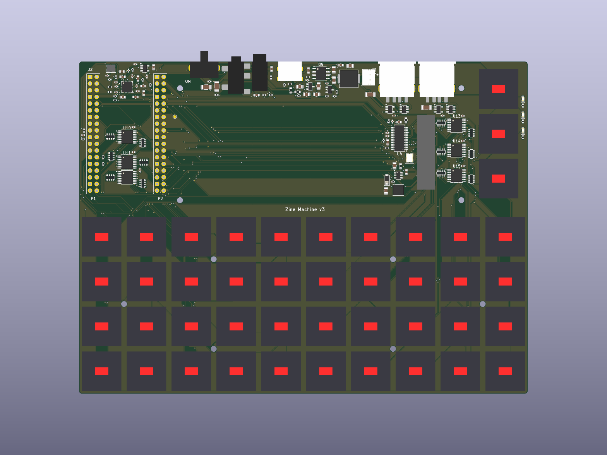

# Zine Machine main board v3 (`bancouver40_pb2`)

The main board of the Zine Machine: the bancouver40 keyboard (40 Kailh Choc v1 keys) plus 3 mode keys, carrying a
**PocketBeagle 2 Industrial** face-down, the 4.58" 320x960 bar panel (RGB565 DPI + 3-wire SPI, unchanged from v2), a
1S LiPo with charger and power switch, a 2-port USB hub and an I2S audio codec. 170 x 126 mm, 4 layers, every
assembled part on the top side. The design spec is [`DESIGN_v3.md`](DESIGN_v3.md); the mechanics (tray, display
chassis, concept model) are in [`../../mech/`](../../mech/).



| Block | Parts |
|---|---|
| Computer | U2 PocketBeagle 2 Industrial, face-down on its own 3.55 mm SMT sockets, USB-C out of the rear wall |
| Keys | 43 Choc v1 (soldered, no hot-swap) wired directly to six 74HC165 (U10-U15, chained, 10k pull-ups RN1-RN12), read by the AM6254's **Cortex-M4F** |
| Display | J3 Amphenol F32Q 40-pin FPC (moved 4 mm -x), U3 TPS61165 backlight boost, PWM on P1.06 |
| USB | U4 FE1.1s hub on USB1 (P1.09/P1.11), U5/U6 TPS2051B 500 mA port switches, U7/U8 USBLC6 ESD, J7/J8 GCT USB1046 rear USB-A |
| Power | J6 rear USB-C (charge only, CC 5.1k), U9 **IP5306** charger/boost (2-LED mode), J5 JST-PH battery, SW44 DPDT slide switch + Q1 P-FET on +5V_SYS, Q2 wake pulse to the IP5306 KEY pin |
| Audio | U17 ES8388 codec as I2S master (X1 12.288 MHz), U16 TPS73633 3.3 V low-noise LDO, J9 headset TRRS (CTIA, detect switch), J10 line-out TRS |
| LEDs | D2 red = charging (blinks) / full (on), D3 green = boost on / low battery (blinks), D4 yellow = boot (P1.35). Right of the mode keys, top to bottom |

## Header pin map (PocketBeagle 2)

P1.n is pad n, P2.n is pad 36+n of U2. The net names are the schematic's. Pins marked — are unconnected (spare).

| Pin | Ball function | Net | | Pin | Ball function | Net |
|---|---|---|---|---|---|---|
| P1.01 | VIN_5V | +5V_SYS | | P2.01 | MCASP0_ACLKX | I2S_BCLK |
| P1.02 | AIN6/GPIO1_10 | — | | P2.02 | VOUT0_D0 | VOUT_D0 |
| P1.03 | USB1_DRVVBUS | — | | P2.03 | MCASP0_AXR1 | I2S_DAC |
| P1.04 | MCASP0_AFSX | I2S_LRCK | | P2.04 | VOUT0_D1 | VOUT_D1 |
| P1.05 | USB1_VBUS | +5V_SYS | | P2.05 | MCU_GPIO0_5 | KEY_QH |
| P1.06 | EHRPWM0_A | BL_PWM | | P2.06 | VOUT0_D2 | VOUT_D2 |
| P1.07 | VIN_USB | — | | P2.07 | MCU_GPIO0_6 | M4F_SPARE |
| P1.08 | GPIO1_14 | HP_DET | | P2.08 | VOUT0_D3 | VOUT_D3 |
| P1.09 | USB1_D- | USB_UP_N | | P2.09 | I2C3_SCL | I2C_SCL |
| P1.10 | GPIO1_30 | — | | P2.10 | GPIO0_91 | LCD_RESET |
| P1.11 | USB1_D+ | USB_UP_P | | P2.11 | I2C3_SDA | I2C_SDA |
| P1.12 | MCASP0_AXR2 | I2S_ADC | | P2.12 | PWR_BTN | — |
| P1.13 | GPIO0_36 | — | | P2.13 | VOUT_VSYS | — |
| P1.14 | VDD_3V3 | +3V3 | | P2.14 | BAT_VIN | — |
| P1.15 | GND | GND | | P2.15 | GND | GND |
| P1.16 | GND | GND | | P2.16 | BAT_TEMP | — |
| P1.17 | AIN_VREF- | — | | P2.17 | VOUT0_PCLK | LCD_PCLK |
| P1.18 | AIN_VREF+ | — | | P2.18 | VOUT0_D8 | VOUT_D8 |
| P1.19 | AIN0 | VBAT_SENSE | | P2.19 | GPIO0_27 | — |
| P1.20 | VOUT0_D5 | VOUT_D5 | | P2.20 | VOUT0_D4 | VOUT_D4 |
| P1.21 | AIN1 | — | | P2.21 | GND | GND |
| P1.22 | GND | GND | | P2.22 | VOUT0_VSYNC | LCD_VSYNC |
| P1.23 | AIN2 | — | | P2.23 | VDD_3V3 | +3V3 |
| P1.24 | VOUT_VSYS | — | | P2.24 | VOUT0_D6 | VOUT_D6 |
| P1.25 | AIN3 | — | | P2.25 | SPI0_D1 | LCD_SDA |
| P1.26 | MCU_GPIO0_13 | KEY_CLK_PB | | P2.26 | nRESET | — |
| P1.27 | AIN4 | — | | P2.27 | SPI0_D0 | — |
| P1.28 | MCU_GPIO0_14 | KEY_SHLD_PB | | P2.28 | VOUT0_HSYNC | LCD_HSYNC |
| P1.29 | VOUT0_DE | LCD_DE | | P2.29 | SPI0_CLK | LCD_SCK |
| P1.30 | UART0_TXD | — | | P2.30 | VOUT0_D13 | VOUT_D13 |
| P1.31 | VOUT0_D14 | VOUT_D14 | | P2.31 | SPI0_CS0 | LCD_CS |
| P1.32 | UART0_RXD | — | | P2.32 | VOUT0_D12 | VOUT_D12 |
| P1.33 | VOUT0_D11 | VOUT_D11 | | P2.33 | VOUT0_D7 | VOUT_D7 |
| P1.34 | GPIO0_26 | — | | P2.34 | VOUT0_D15 | VOUT_D15 |
| P1.35 | GPIO0_88 | LED_BOOT | | P2.35 | VOUT0_D9 | VOUT_D9 |
| P1.36 | VOUT0_D10 | VOUT_D10 | | P2.36 | AIN7 | — |

Software notes:
- **Key scan (Cortex-M4F):** CLK = P1.26 (MCU_GPIO0_13), SH/LD = P1.28 (MCU_GPIO0_14), QH = P2.05 (MCU_GPIO0_5). Those
  header pins also carry main-domain balls (GPIO0_44, GPIO0_43, GPIO1_24): keep them unmuxed inputs in Linux. Pull
  SH/LD low to latch, then clock 48 bits; the first bit out is U10.H. Keys pull to GND (pressed = 0); the 5 spare
  inputs (U12.E-H, U15.H) read 1. Bit order per chip: H, G, F, E, D, C, B, A, chain U10 -> U15 (see `tools/zm_v3/design.py` `INPUTS`).
- **Pins with two balls** (P1.04/06/12, P2.01/03/07/09/11 ...): mux only the ball named in the table, keep the twin an input.
  P2.03's I2S data uses ball B18 (MCASP0_AXR1); the MDIO ball AB22 stays an input.
- **I2S:** the ES8388 is the master (BCLK/LRCK out from 12.288 MHz); McASP0 is the slave. I2C3 (P2.09/P2.11, 2.2k
  pull-ups) carries only the ES8388 (address 0x10).
- **Battery level:** P1.19 (AIN0) sees VBAT/2 through 1M/1M (the IP5306 has no I2C in this build).
- **Headset detect:** P1.08 reads high with a plug in (100k pull-up; the jack's switch shorts it to the R channel's 10k when empty).
- **USB1** runs in host mode; P1.05 (USB1_VBUS) sits on +5V_SYS through the PocketBeagle's own divider; P1.03 DRVVBUS is unused (ports are always powered).

## Stack-up

4 layers, 1.6 mm, the fab's standard build (7628 prepreg):

| Layer | Use |
|---|---|
| F.Cu (35 µm) | parts, most signals, GND fill |
| prepreg 0.21 mm | |
| In1.Cu | **solid GND plane** (only clearance holes) |
| core 1.065 mm | |
| In2.Cu | signals + GND fill |
| prepreg 0.21 mm | |
| B.Cu (35 µm) | signals, key traces, GND fill |

Rules: 0.127 mm clearance on every net class, 0.15 mm minimum track, vias 0.6/0.3 mm (four 0.5/0.3 mm in the
codec's exposed pad), copper 0.3 mm from the edge. Track widths: 0.15 signals, 0.3 for 3.3 V and USB, 0.4 for GND,
snubbers and the backlight, 0.6 for +5V_SYS, +5V_BOOST, VBAT, VIN_CHG and the charger's switch node. The upstream USB
pair is a fixed 0.3/0.15 mm coupled pair on F.Cu over In1 (about 86 ohm differential); the downstream pairs are
routed as coupled pairs too.

## Decisions (stages 1-3)

- **Plain IP5306, not IP5306-I2C:** the I2C variant turns LED1-3 into SCL/SDA/IRQ, so it cannot drive the charge LED
  the design asks for. The plain part in 2-LED mode gives a charge LED and a power/low-battery LED; battery level comes
  from the VBAT divider on AIN0 instead. The I2C part has the same ESOP-8 footprint if that trade is ever wanted.
- **Power switch:** the DPDT slide switch carries no load current. Pole A grounds the gate of Q1 (AO3401A) between
  the boost output and +5V_SYS (soft-started by 10k/100nF); pole B gives the IP5306 KEY pin one ~0.4 s press through
  C30/R29/Q2 so the sleeping boost wakes. OFF drops +5V_SYS; charging keeps working. ON = knob toward the "ON" mark (-x).
- **TPS2051B** port switches (SY6280 has no fault output): 500 mA each, open-drain OC# wire-ORed to the hub's OVCJ.
- **ES8388 mic bias** from AVDD through 1k/10µF and 2.2k (the ES8388 has no MICBIAS pin).
- **74HC165 placement:** the strip between the battery and row 0 is too narrow for any 165 package, so three sit
  under the PocketBeagle (TSSOP-16, <= 1.2 mm under the module's height map) and three between J3 and the mode keys.
- **Under the PocketBeagle:** every part is checked against `mech/pb2_underside_keepout.csv` with 0.3 mm margin;
  0.5 mm courtyard spacing and a 2.2 mm part-free lane beside each header row keep the inner header pins routable.
- **Connectors:** GCT USB1046 USB-A (the first pick's 2.3 mm shell holes collided at the 15.1 mm port pitch),
  through-hole PJ-320A line-out jack (the SMD jacks' side pads collided at the 9 mm jack pitch), FNR4030S 22 µH and
  B5819W in the backlight boost (SRN4018 and MBR0540 out of stock).
- **4 layers instead of 2:** on 2 layers about 13 decoupling capacitors' GND pads ended up walled in by routing with
  no way to the ground pour. A solid In1 GND plane gives every GND pad a via to ground and the codec, regulators,
  display bus and USB a continuous return.
- **USB hub turned 180 deg** so the upstream pair lands on DMU/DPU without crossing.

## Routing tools and how to reproduce

Everything is generated from one design model, `tools/zm_v3/design.py` (parts, MPNs, pin-to-net):

```sh
python3 tools/zm_v3/gen_sch.py pcb/bancouver40_pb2/bancouver40_pb2.kicad_sch   # schematic (root + 4 sheets) + zm_v3.kicad_sym
python3 tools/zm_v3/gen_fp.py  pcb/bancouver40_pb2                              # custom footprints + 3D body list
python3 tools/zm_v3/gen_pcb.py pcb/bancouver40_pb2/build/stage.kicad_pcb        # placed, unrouted board (fixed USB pair)
sh tools/zm_v3/krt_route.sh pcb/bancouver40_pb2/build/stage.kicad_pcb /tmp/krt/work   # route (see below)
sh tools/zm_v3/finish.sh <dir> <board-name>                                     # close the last few connections
sh tools/zm_v3/make_fab.sh                                                      # ERC/DRC + fab/ outputs
```

Routing uses [KiCadRoutingTools](https://github.com/drandyhaas/KiCadRoutingTools) (GND plane on In1, diff pairs, then
everything with rip-up) **with `--escalation off --fab-tier standard`** (by default it drops below the fab limits).
It finishes about 147 of 154 nets; `finish.sh` closes the rest with `connect.py` (A* with rip-up over F/In2/B) and
KiCadRoutingTools rerouting the ripped nets. The router binary has to be built from source on ARM Linux (Rust, see
its README). Freerouting (`dsn.py` exports a Specctra DSN) was tried and left more open connections.
Routes are not deterministic; a rerun gives different, equally checked copper.

**Gotcha:** Backplane's headless KiCad writes its in-memory project settings back to `bancouver40_pb2.kicad_pro`
on every save. Close the board in the server before editing the .pro and re-check the clearance rules (0.127 mm)
after any save through it; `kicad-cli pcb drc --refill-zones --save-board` refills without the server.

## Fab outputs (`fab/`)

| File | |
|---|---|
| `bancouver40_pb2-gerbers.zip` | Gerbers (F/In1/In2/B Cu, mask, paste, silk, Edge.Cuts) + PTH/NPTH Excellon drill |
| `bancouver40_pb2-bom.csv` | assembly BOM: 45 lines, 130 top-side parts, MPN + fab part number on every line |
| `bancouver40_pb2-cpl.csv` | placement for the same 130 parts (top) |
| `bancouver40_pb2-parts-hand-fit.csv` | fitted by hand: 43 Choc v1 switches, the PocketBeagle and its 2x 2x18 male headers, J10, SW44, J5 (through-hole, kept off the assembly order so it stays single-sided SMD) |
| `-drc.rpt`, `-erc.rpt`, `-schematic.pdf`, `-assembly-top.pdf` | checks and documentation |

Checks at release: ERC 0, DRC 0 violations / 0 unconnected / schematic parity clean (kicad-cli 10.99).
Order with `bancouver40_pb2.fab.json` (pcb, 4 layers, 1.6 mm, green, lead-free HASL). Check the part rotations in
the fab's placement preview before paying (KiCad and the fab disagree on some package zero orientations).

## Verify before ordering

1. **Headset jack pinout (PJ-327A 5JJ):** the pin functions (2 tip/L, 4 ring1/R with detect 5, 3 ring2/GND,
   1 sleeve/MIC, CTIA) are read from the maker's drawing, which has no pin table. Check one with a TRRS plug and a meter.
2. **GCT USB1046 height:** assumed 7.0 mm (the tray is cut for that); GCT's drawing was not reachable. Only 75 are in
   the fab's stock (10 per 5 boards).
3. **Panel FPC contact side and fold length:** J3 is the top-contact F32Q (F32R bottom-contact has the same land
   pattern); lay a real panel on a printout before committing.
4. **Power budget:** the IP5306 delivers 2.1-2.4 A at 5 V. PocketBeagle (~1 A peak) + 2 x 0.5 A USB + backlight
   (~0.15 A) + hub/codec is about 2.3 A worst case.
5. **Battery polarity:** J5 pin 1 (square pad, "+" on the silk) is VBAT. LiPo packs with JST-PH plugs come in both
   polarities; check before plugging in.
6. **PocketBeagle headers:** the 2x18 male headers go in from below (plastic under the board) and need trimming so
   they do not bottom out in the 3.55 mm sockets.
7. **Mic and line-out levels, ES8388 register setup and the M4F key-scan firmware** are software work; nothing on the
   board depends on them being finished first.

## v2

The previous design (ATmega32U4 + hot-swap keyboard, 2 layers) is in git history before commit `be75325`
(`git show 0ab480b:pcb/bancouver40_pb2/README.md`); the 2" LCD version before it is in `v1_2in_lcd/`.
